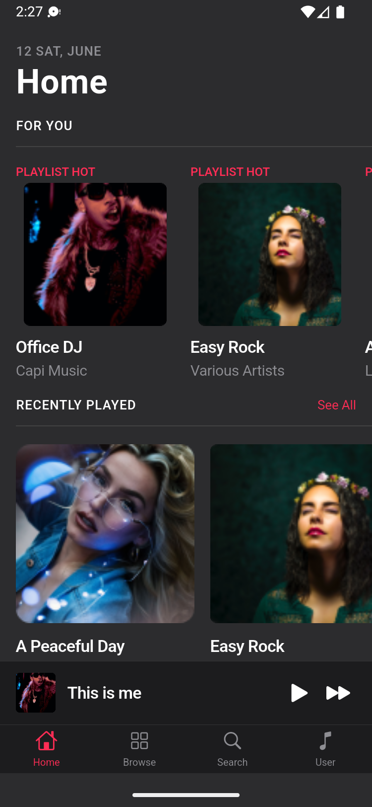
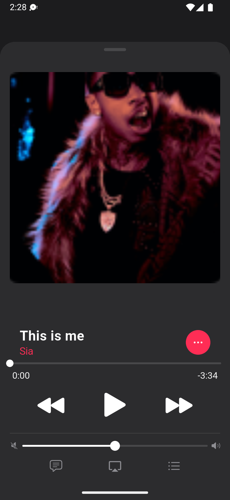
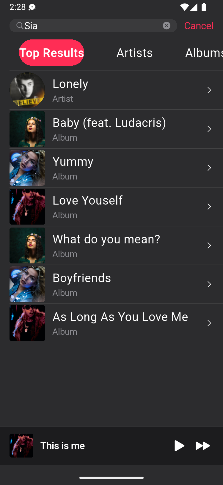
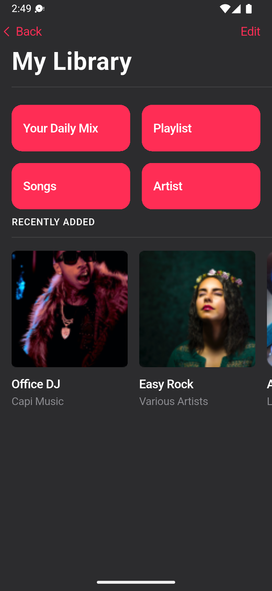
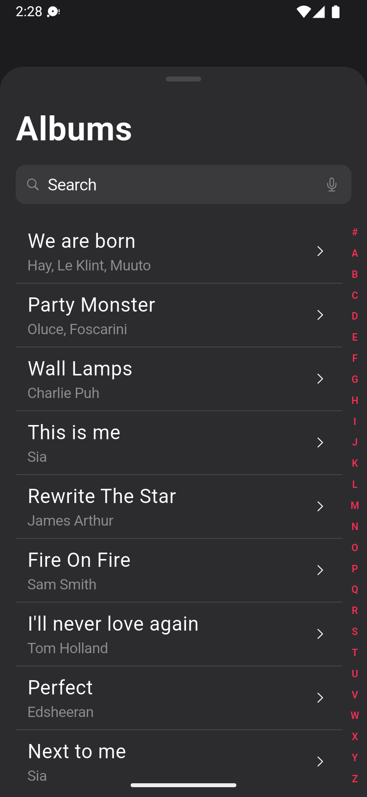
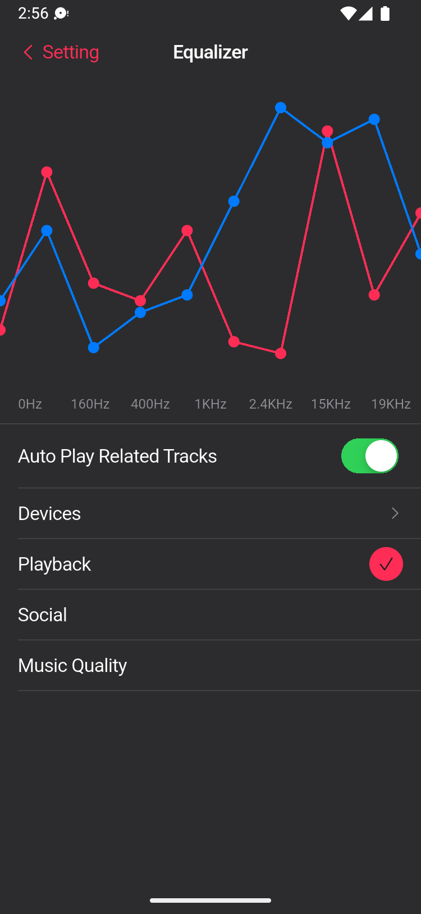

# GLORIES Music · Flutter 复刻工程

> 依据 Pixso 设计文件 **GLORIES Music (iOS 14)** 的 23 张 375×812 画板，用 Flutter + Cupertino 组件库完整复刻的移动端 App。
> 设计稿导出图在 `docs/screenshots/`，App 实机（Android 模拟器 375×812 逻辑像素）截图在 `docs/screenshots/app/`。

---

## 1. 技术选型

| 项目 | 选择 | 原因 |
| --- | --- | --- |
| 框架 | Flutter 3.13.5+ / Dart | 一套代码覆盖 iOS、Android |
| UI 组件 | **仅 `flutter/cupertino`** | 设计稿是 iOS 14 规范，Material 组件的圆角/水波纹会破坏还原度 |
| 第三方运行时依赖 | 无（仅 `cupertino_icons`） | 播放、状态、路由全部自研，避免为静态视觉稿引入音频插件 |
| 状态管理 | `ChangeNotifier` + `InheritedNotifier` | 全局只有"正在播放"这一份状态，无需 Redux/Bloc 级别的基础设施 |
| 图标 | `CupertinoIcons`，仅 `Icons.airplay` / `Icons.apple` 两个来自 Material | 用 `show Icons` 精确导入，不引入整套 Material 主题 |

---

## 2. 目录结构

```
GLORIESMusic/
├── assets/images/              # 从画板导出的 8 张真实位图（专辑/艺人/分类封面）
├── docs/
│   └── screenshots/            # 23 张设计稿参考图
│       └── app/                # App 实机截图（与设计稿同编号，便于逐张比对）
├── lib/
│   ├── main.dart               # 唯一入口：runApp(const GloriesApp())
│   ├── app/
│   │   └── glories_app.dart    # CupertinoApp 根：持有 AppStore、注入主题与 AppScope
│   ├── core/                   # 与设计稿一一对应的"基础设施"
│   │   ├── design/             # 设计令牌：app_colors / app_dims / app_typography / app_theme
│   │   ├── models/media.dart   # AppArt 资源表 + Track / Collection / Artist / Category
│   │   ├── data/catalog.dart   # 静态曲库（文案全部取自画板，保证界面文字与设计稿一致）
│   │   └── state/              # app_store.dart（可变状态）+ app_scope.dart（向下广播）
│   ├── widgets/                # 跨页面复用的展示型组件
│   │   ├── app_shell.dart      # 4 个根 Tab 的外壳：背景 + MiniPlayer + TabBar
│   │   ├── app_sheet.dart      # 卡片式弹层（Now Playing / Albums / Scans 共用）
│   │   ├── page_chrome.dart    # BackLabel / LargeTitleHeader / SectionEyebrow
│   │   ├── rows.dart           # LinkRow / TrackRow / Hairline / ArtSlot
│   │   ├── cards.dart          # MediaCard / CategoryTile / MediaRail
│   │   ├── buttons.dart        # PrimaryButton / AccentIconButton / FilledPillButton / GenreChip / FilterPillBar
│   │   ├── player_controls.dart# SeekBar / TransportRow / VolumeBar / PlayerTabRow / PlayerHeader / AppSlider
│   │   ├── mini_player.dart    # 常驻底部播放条
│   │   └── art_image.dart      # 圆角封面 + 无位图时的渐变兜底
│   └── features/               # 按画板分类的页面，一个目录 = 设计稿里的一个页面组
│       ├── root_page.dart      # 启动分流：引导页 → Tab 外壳
│       ├── onboarding/         # Walkthrough #1–#3
│       ├── home/               # Home
│       ├── browse/             # Browse、Radio #1、Albums
│       ├── search/             # Search #1–#4、Scans
│       ├── library/            # Your Library、Daily Mix / Playlist / Album 详情
│       ├── player/             # Now Playing #1–#5 + TrackActionsSheet
│       └── profile/            # Profile、Setting #1、Setting #2(Equalizer)
└── test/
    ├── screens_test.dart       # 17 个界面在 375×812 下的溢出守卫
    └── widget_test.dart        # 引导流程、流派选择、播放条、Tab 切换四条交互链路
```

分层依赖是单向的：`features → widgets → core`，`core` 不反向依赖任何页面，`widgets` 不持有业务状态（全部通过参数或 `AppScope.of(context)` 读取）。

---

## 3. 设计令牌（`lib/core/design/`）

设计稿里的颜色、圆角、间距、字号被完整翻译成三个 `abstract final class`，页面里**不允许出现裸的 `Color(0x…)` 或魔法数字**。

### AppColors

| Token | 值 | 用途 |
| --- | --- | --- |
| `canvas` | `#2C2C2E` | 页面底色（Gray 1） |
| `canvasDeep` | `#1C1C1E` | 卡片式弹层背后的遮罩层 |
| `surface` | `#3A3A3C` | 搜索框、列表条 |
| `surfaceHigh` | `#48484A` | 悬浮态、次级按钮底 |
| `accent` | `#FF2D55` | 品牌粉：CTA、选中态、返回箭头 |
| `accentSoft` | `#33FF2D55` | 品牌粉的 20% 底（选中芯片） |
| `blue` / `green` | `#007AFF` / `#34C759` | 均衡器双曲线、iOS 开关 |
| `textPrimary/Secondary/Tertiary` | `#FFF` / `#8E8E93` / `#48484A` | 三级文字 |
| `separator` | `#1AFFFFFF` | 1px 分割线 |
| `playerGradient` | `#2A1F3D → #1D2A4A → #3A1F3F` | Now Playing 展开态背景 |

### AppDims

`gutter 16`（画板里内容 x=1756、画板起点 x=1740）、`rowHeight 44`、`radiusCard 6`、`radiusTile 14`、`radiusSheet 24`、`miniPlayerHeight 64`、`tabBarHeight 49`、`homeIndicatorHeight 34`。

### AppTypography

按 iOS 14 HIG 逐级还原：`largeTitle 34 / title1 28 / title2 22 / title3 20 / headline 17·w600 / body 17 / callout 16 / subheadline 15 / footnote 13 / overline 13·w600 / caption 12`，并带上画板里的 `letterSpacing`。
`AppTypography.button` 故意**不设 color**，让它继承主题的 action 色；只有在粉色填充上（`PrimaryButton`）才显式 `copyWith(color: textPrimary)`。
`SF Pro` 仅在 Apple 平台存在，其它平台由 Flutter 回退到系统字体——这是预期行为。

---

## 4. 状态与数据流

```
GloriesApp (StatefulWidget)
 └── AppStore  ← 唯一可变状态源（ChangeNotifier）
     └── AppScope (InheritedNotifier<AppStore>)   ← 挂在 Navigator 之上
         └── CupertinoApp.builder
             └── RootPage → Walkthrough / AppShell(4 Tabs) → 各详情路由 / 弹层
```

关键点：`AppScope` 通过 `CupertinoApp.builder` 注入到 **Navigator 之上**，这样任何被 `push` 的路由和被 `showModalBottomSheet` 弹出的层都能 `AppScope.of(context)` 读到同一个 store；如果把它放在 `home:` 下面，播放器页面就拿不到状态了。

`AppStore` 用 `Timer.periodic(1s)` 模拟播放进度：设计稿没有音频资源，一个 tick 就足以让 **进度条 / MiniPlayer / 歌词高亮 / 剩余时长** 四处保持同步，而不用引入平台音频插件。

`Catalog`（`core/data/catalog.dart`）是静态曲库，所有标题、艺人名、文案都直接取自画板文字，因此跑起来的 App 与截图逐字可比。

---

## 5. 界面清单与代码映射

| # | 画板 | 实现文件 | 实机截图 |
| --- | --- | --- | --- |
| 01–03 | Walkthrough #1–#3 | `features/onboarding/walkthrough_page.dart` | `01/02/03-walkthrough-*.png` |
| 04 | Home | `features/home/home_page.dart` | `04-home.png` |
| 05 | Now Playing #1（封面态） | `features/player/now_playing_page.dart` | `05-now-playing.png` |
| 06 | Now Playing #2（沉浸态） | 同上，`PlayerTabRow` 选中即展开 | `05b-now-playing-immersive.png` |
| 07 | Now Playing #3（歌词） | 同上 `_Lyrics` | `07-now-playing-lyrics.png` |
| 08 | Now Playing #4（更多操作） | 同上 `TrackActionsSheet` | `08-track-actions.png` |
| 09 | Now Playing #5（播放队列） | 同上 `_Queue` | `09-now-playing-queue.png` |
| 10 | Daily Mix | `features/library/collection_page.dart` | `10-daily-mix.png` |
| 11 | Playlist | 同上（`CollectionKind` 决定序号/下载图标） | `11-playlist.png` |
| 12 | Radio #1 | `features/browse/radio_page.dart` | `12-radio.png` |
| 13 | Browse | `features/browse/browse_page.dart` | `13-browse.png` |
| 14 | Your Library | `features/library/library_page.dart` | `14-library.png` |
| 15 | Albums | `features/browse/albums_sheet.dart` | `15-albums.png` |
| 16 | Search #1（空闲） | `features/search/search_page.dart` | `16-search.png` |
| 17 | Search #2（输入建议） | 同上（焦点态切换 body） | `17-results.png` 前置态 |
| 18 | Search #3（结果+筛选） | `features/search/results_page.dart` | `17-results.png` |
| 19 | Search #4（筛选切换） | 同上 `FilterPillBar` | 同 `17-results.png` |
| 20 | Scans | `features/search/scans_sheet.dart` | `20-scans.png` |
| 21 | Setting #1 | `features/profile/settings_page.dart` | `21-settings.png` |
| 22 | Setting #2 / Equalizer | `features/profile/equalizer_page.dart` | `22-equalizer.png` |
| 23 | Profile | `features/profile/profile_page.dart` | `23-profile.png` |

另有 `06-album.png`：点任意专辑进入的详情页，复用 `CollectionPage`（画板未单独给出，但交互上必须存在）。

### 导航图

```
RootPage ──▶ WalkthroughPage ──▶ AppShell
                                  ├─ HomePage ─────┬─▶ CollectionPage（卡片）
                                  │                └─▶ AlbumsSheet（See All / 播放条）
                                  ├─ BrowsePage ───┬─▶ RadioPage ──▶ CollectionPage
                                  │                └─▶ CollectionPage
                                  ├─ SearchPage ───┬─▶ ResultsPage（输入回车）
                                  │                └─▶ ScansSheet
                                  └─ ProfilePage ──┬─▶ LibraryPage ─▶ CollectionPage
                                                   ├─▶ SettingsPage ─▶ EqualizerPage
                                                   └─▶ AlbumsSheet / CollectionPage
MiniPlayer（常驻）──▶ NowPlayingPage ──▶ TrackActionsSheet
```

---

## 6. 主要界面

| Home | Now Playing | Search 结果 |
| --- | --- | --- |
|  |  |  |

| Your Library | Albums 弹层 | Equalizer |
| --- | --- | --- |
|  |  |  |

---

## 7. 自定义绘制

Cupertino 没有现成控件能画的东西，全部用 `CustomPainter` 直接实现，集中在两个文件：

- `widgets/player_controls.dart` — `AppSlider` / `_SliderPainter`：细轨道 + 圆thumb 的进度条与音量条（`SeekBar`、`VolumeBar` 共用）。
- `features/profile/equalizer_page.dart` — `_CurvePainter`：Setting #2 里粉/蓝两条带圆点顶点的折线。
- `features/search/scans_sheet.dart` — `_Waveform`：Scans 封面之上的静态声波条。
- `widgets/art_image.dart` — 画板里只有 8 张真实位图，其余封面是占位填充色；`ArtImage` 在取不到位图时用主题渐变兜底，保证不会出现空白方块。

---

## 8. 运行与验证

```bash
flutter pub get
flutter run                                   # 真机/模拟器
flutter test                                  # 21 个用例
flutter build apk --release                   # 约 17 MB
```

- `test/screens_test.dart`：把 17 个界面逐个渲染到 375×812 画布，任何布局溢出都会在 `tester.takeException()` 处失败——这是全 App 的溢出守卫。
- `test/widget_test.dart`：走 4 条真实交互链路（引导页交接、流派标签、播放条与歌词、Tab 切换与搜索输入）。
- 注意：`AppStore` 的 1s tick 是常驻定时器，测试里用 `settle()`（8×100ms 手动 pump）代替 `pumpAndSettle()`，否则会一直等待帧而超时。
- 机器负载高时（模拟器 + Gradle 同时在跑）`flutter test` 的并发 isolate 可能加载超时报 "did not complete"；单独跑 `flutter test test/<file>` 即可确认与布局无关。

### 截图流水线

模拟器以 `750×1624 @ 320dpi` 覆盖启动（逻辑 375×812，正好 2px/pt），逐屏 `adb shell input tap` + `screencap` 采集，输出与画板同编号放入 `docs/screenshots/app/`，可与 `docs/screenshots/` 里的设计稿一一对位比对。

---

## 9. 已知取舍

1. **无音频引擎**：播放是 1 秒 tick 的模拟进度，符合"视觉稿复刻"的范围；接入真实音频时只需替换 `AppStore._advance()`。
2. **Browse 是根 Tab 却带 `< Back`**：画板如此，为还原度保留；`Navigator.maybePop()` 在根路由上是安全的空操作。
3. **Daily Mix 与 Playlist 画板标题都是 "Daily Mix 1"**：设计稿本身的笔误，实现按 `CollectionKind` 区分序号与下载图标。
4. **曲库为静态**：`Catalog` 里的文案与画板逐字一致，便于比对截图，不是数据层设计。
